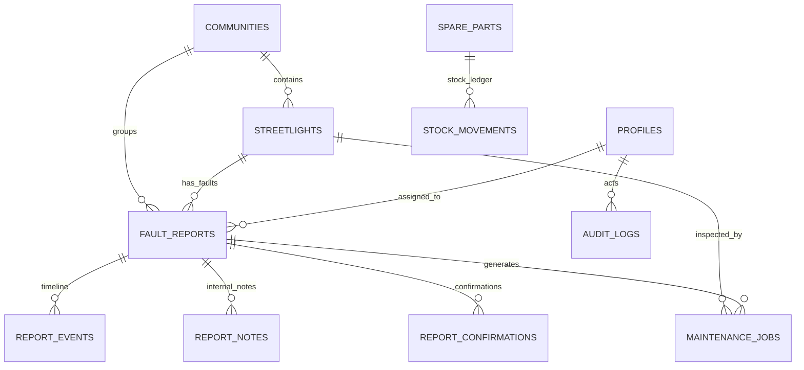

# OTMA backend database schema reference

This describes the PostgreSQL schema created by the migrations in `supabase/migrations/`.

## Main entity relationships

## Tables

| Table | Purpose | Important fields |
|---|---|---|
| `communities` | Controlled community/locality list | `id`, `name`, `is_active`, `display_order` |
| `profiles` | Staff profile attached to Supabase Auth | `id` (auth user UUID), `email`, `full_name`, `role`, `is_active` |
| `streetlights` | Physical pole/lamp inventory | `id` (`OTMA-SL-00001`), coordinates, `community_id`, `lamp_type`, `status`, pole fields, dates, `is_demo` |
| `fault_reports` | Citizen/field reports from receipt through closure | `reference`, `streetlight_id`, `latitude`, `longitude`, issue, priority, status, reporter contact, SLA, resolution evidence |
| `report_events` | Append-only report workflow timeline | `report_reference`, from/to status, public message, actor, timestamp |
| `report_notes` | Staff-only internal notes | report, author, note, timestamp |
| `report_confirmations` | Deduplicated community confirmations | report, phone hash, timestamp |
| `maintenance_jobs` | Planned inspections and repair jobs | asset/report, task, scheduled date, assigned staff, status |
| `spare_parts` | Parts inventory | SKU, name, quantity, reorder level, unit |
| `stock_movements` | Parts movement ledger | SKU, quantity delta, reason, report, actor; authenticated quantity changes are posted through `stock_movements`; a database trigger applies each movement atomically |
| `contact_messages` | Public contact/enquiry submissions | name, email, phone, subject, message, handling status |
| `app_settings` | Controlled admin settings | key, JSON value, updated actor/time |
| `audit_logs` | Staff and data-change audit trail | actor, action, entity, changed field names, timestamp |
| `request_rate_limits` | Hashed-IP short-window throttle records | IP hash, action, timestamp |

## Column reference

Column names below are the database names (snake_case). Times are stored as `timestamptz` in UTC. The application should render them in the user's local time zone.

### `communities`

| Column | Type | Rules / purpose |
|---|---|---|
| `id` | uuid | Primary key; generated UUID |
| `name` | text | Required; unique official locality name |
| `is_active` | boolean | Defaults true; hides retired localities from public selection |
| `display_order` | integer | Defaults 0; UI ordering |
| `created_at` | timestamptz | Defaults now |

### `profiles`

| Column | Type | Rules / purpose |
|---|---|---|
| `id` | uuid | Primary key and FK to `auth.users.id` |
| `email` | text | Required; unique; staff personal data |
| `full_name` | text | Required; staff personal data |
| `phone` | text | Nullable; staff personal data |
| `role` | text | `administrator`, `assembly_officer`, `technician`, `auditor`, `pending` |
| `is_active` | boolean | Defaults false; inactive until activated by administrator |
| `created_at`, `updated_at` | timestamptz | Generated/maintained by database |
| `last_seen_at` | timestamptz | Nullable; reserved for future sign-in telemetry |

### `streetlights`

| Column | Type | Rules / purpose |
|---|---|---|
| `id` | text | Primary key; pattern `OTMA-SL-00001`; sequence default for new records |
| `latitude`, `longitude` | double precision | Required; range checked |
| `community_id` | uuid | Nullable FK to `communities.id` |
| `street` | text | Required street/road description |
| `lamp_type` | text | Required lamp technology/type |
| `status` | text | `working`, `faulty`, `under_repair`, `out_of_service` |
| `last_repaired_date` | date | Nullable |
| `pole_height_m` | numeric(5,2) | Nullable pole height in metres |
| `wattage` | integer | Nullable lamp wattage |
| `pole_material` | text | Nullable material description |
| `pole_condition` | text | Nullable condition description |
| `installation_date` | date | Nullable |
| `asset_note` | text | Nullable staff-only note; do not copy into public map views |
| `is_demo` | boolean | Defaults false; records designated non-operational by trusted server-side processes only |
| `qr_code_value` | text | Generated stored value; the QR resolver route must be configured before use |
| `created_at`, `updated_at` | timestamptz | Generated/maintained by database |
| `created_by`, `updated_by` | uuid | Nullable staff profile FKs |

### `fault_reports`

| Column | Type | Rules / purpose |
|---|---|---|
| `reference` | text | Primary key; generated by `create-report` |
| `streetlight_id` | text | Nullable FK to `streetlights.id`; null for map-only reports |
| `community_id` | uuid | Nullable FK to `communities.id` |
| `street` | text | Nullable road description or captured street name |
| `latitude`, `longitude` | double precision | Required report coordinates |
| `issue_type` | text | Fault type label / enum value from API |
| `description` | text | Required 10–1,000 characters; reporter PII may be embedded, restrict access |
| `priority` | text | `low`, `normal`, `medium`, `high`, `critical` |
| `status` | text | `received`, `verified`, `assigned`, `in_progress`, `awaiting_parts`, `resolved`, `closed` |
| `reporter_name`, `reporter_phone` | text | Reporter personal data; phone required |
| `is_demo` | boolean | Defaults false; non-operational records excluded from public map/stats |
| `nearby_landmark` | text | Nullable free-text location guidance |
| `photo_path`, `after_photo_path` | text | Nullable private Storage object paths, never public URLs |
| `confirmation_count` | integer | Non-negative aggregate number |
| `assigned_to` | uuid | Nullable FK to `profiles.id`; active technician required by action API |
| `sla_due_at` | timestamptz | Required SLA deadline |
| `resolution_action`, `parts_used` | text | Required for a live report to transition to resolved; record `None` if no parts used |
| `resolved_at`, `closed_at` | timestamptz | Set by database when the respective transition succeeds |
| `reported_at`, `updated_at` | timestamptz | Generated/maintained by database |
| `created_by`, `updated_by` | uuid | Nullable staff profile references |

### Workflow and private operational tables

| Table | Important columns | Access / notes |
|---|---|---|
| `report_events` | `id`, `report_reference`, `event_type`, `from_status`, `to_status`, `public_message`, `internal_note`, `actor_id`, `created_at` | Status timeline. Public tracking returns only `public_message`; never return `internal_note`. |
| `report_notes` | `id`, `report_reference`, `author_id`, `note`, `created_at` | Internal notes; active oversight staff or the assigned technician only. |
| `report_confirmations` | `id`, `report_reference`, `phone_hash`, `created_at` | One hashed phone confirmation per report/phone hash. Raw phone is not stored here. |
| `maintenance_jobs` | `id`, `streetlight_id`, `report_reference`, `asset_label`, `task`, `scheduled_for`, `assigned_to`, `status`, `notes`, `completed_at`, `created_by`, `updated_by`, `created_at`, `updated_at` | Work/inspection calendar. Technician work changes go through `maintenance-action`. |
| `spare_parts` | `sku`, `name`, `quantity`, `reorder_level`, `unit`, `updated_at`, `updated_by` | Quantity must be non-negative. The `stock_movements` trigger applies each submitted delta to the on-hand quantity atomically; direct quantity writes are revoked. |
| `stock_movements` | `id`, `sku`, `quantity_delta`, `reason`, `report_reference`, `actor_id`, `created_at` | Append-style inventory movement ledger; positive values add stock, negative values consume stock. |
| `contact_messages` | `id`, `name`, `email`, `phone`, `subject`, `message`, `status`, `created_at`, `handled_by`, `handled_at` | Personal enquiry data; staff-only. |
| `app_settings` | `setting_key`, `setting_value`, `updated_at`, `updated_by` | JSON configuration; administrator-only. |
| `audit_logs` | `id`, `actor_id`, `action`, `entity_type`, `entity_id`, `metadata`, `created_at` | Metadata records changed field names only, not field values. |
| `request_rate_limits` | `id`, `ip_hash`, `action`, `created_at` | Internal salted IP hashes; service-role only. Old rows are pruned by the rate-limit function. |

### View contracts

- `streetlights_public`: `id`, `latitude`, `longitude`, `community`, `street`, `lampType`, `status`, `lastRepairedDate`, `poleHeightM`, `wattage`, `poleMaterial`, `poleCondition`, `installationDate`. It excludes `is_demo=true` and internal notes/audit fields.
- `staff_directory`: `id`, `full_name`, `role`, `is_active`, `last_seen_at`, `created_at`. Authenticated active staff only; no email or phone.
- `staff_admin_directory`: `id`, `email`, `full_name`, `phone`, `role`, `is_active`, `last_seen_at`, `created_at`. Administrator only.

### Key database functions and triggers

- `public.validate_fault_report_update()`: rejects illegal report-state transitions; requires action text, parts-used entry and after-photo path for live resolutions; stamps `resolved_at` and `closed_at`.
- `public.record_report_status_change()`: creates public-safe timeline events and synchronises streetlight status against its remaining open reports.
- `public.consume_request_rate_limit(...)`: atomic advisory-lock-backed rate limiter; service role only.
- `public.public_statistics_summary()`: aggregate-only live statistics, excludes non-operational records.
- `GET /functions/v1/admin-overview`: role-checked dashboard aggregation; returns safe KPIs, map points, attention lists, activity and 300 m / 24-hour outage clusters. It does not return reporter names, phone numbers, descriptions or internal notes.
- `public.audit_row_change()`: field-name-only audit entries for operational changes.
- `public.apply_stock_movement()`: applies each stock movement delta to the spare-part balance in the same transaction; direct quantity writes are revoked.
- `public.prevent_client_demo_flag_changes()`: prevents browser roles from creating/changing demo flags.

## Views

- `streetlights_public`: selected streetlight inventory fields for the public map; no reporter/staff personal data.
- `staff_directory`: active staff names and roles for authorised assignment pickers; no email/phone.
- `staff_admin_directory`: account details for active administrators only.

## Streetlight statuses

- `working`
- `faulty`
- `under_repair`
- `out_of_service`

## Fault report statuses

1. `received`
2. `verified`
3. `assigned`
4. `in_progress`
5. `awaiting_parts`
6. `resolved`
7. `closed`

The database rejects invalid live status transitions. Live fault reports automatically move a working asset to `faulty`, then to `under_repair` when work starts, and back to `working` after the last open report is resolved. Demo reports do not mutate demo asset statuses; their seeded timeline is preserved. A live report cannot be marked `resolved` without a work description, a parts-used entry (use `None` where applicable), and a stored after-repair photo path. Spare-part quantity changes are made only by inserting a signed `stock_movements.quantity_delta` entry; the trigger applies the balance and rejects negative stock. Demonstration fixtures (`is_demo=true`) bypass this requirement solely so the sample UI can be exercised.

## Staff roles

- `administrator`: account administration, settings and full operational control.
- `assembly_officer`: inventory, reports, assignments, maintenance and parts operations.
- `technician`: assigned job visibility, internal notes and repair actions for jobs assigned to them.
- `auditor`: read-only oversight, audit/report review.
- `pending`: new account awaiting first-admin activation.

## Privacy and security notes

`fault_reports.reporter_name`, `fault_reports.reporter_phone`, report descriptions, and private photo object paths are reporter personal data (reporter PII). They are not exposed by public tracking or public statistics. Authenticated staff access is limited by role and, for technicians, assignment. Keep these fields out of public views, logs, analytics exports and URLs.

- Every application table has Row Level Security enabled.
- Public report submissions, lookups, contact submissions and statistics execute through server-side Edge Functions.
- Public tracking returns only report reference, issue/location summary, status and public timeline messages; it never returns reporter phone, reporter name, photo object path or internal notes.
- Report and repair photos are held in private Storage buckets. Administrator, Assembly Officer and Auditor roles can review evidence; Technicians can access only reports assigned to them.
- Rate limiting stores only salted SHA-256 IP hashes, never raw IP addresses.
- Audit metadata contains changed field names only, not the values of personal data.
- Do not add real asset coordinates until OTMA validates the GIS inventory and municipal boundary.

## Frontend integration mapping

The existing approved frontend contains `js/backend.js` and `js/config.js` as the adapter/configuration layer. During the separate integration stage, its API contract should use:

| Frontend action | Backend resource |
|---|---|
| Public map/list | `streetlights_public` view |
| Submit report | Edge Function `create-report` |
| Track reference | Edge Function `track-report` |
| Public dashboard metrics | Edge Function `public-stats` |
| Contact form | Edge Function `contact-message` |
| Staff sign-in/session | Supabase Auth + `profiles` |
| Safe technician picker | `staff_directory` view |
| Admin account screen | `staff_admin_directory` view (administrator only) |
| Staff workspace data | `streetlights`, `fault_reports`, `report_events`, `report_notes`, `maintenance_jobs`, `spare_parts`, `app_settings` under RLS |
| Invite staff | Edge Function `admin-invite` |
| Staff report actions | Edge Function `report-action` |
| Maintenance job actions | Edge Function `maintenance-action` |

The approved frontend adapter currently reads the `profiles` table for the staff directory. The integration pass must change that read to `staff_directory` / `staff_admin_directory` according to role; it must not weaken profile RLS to make the existing query work.
